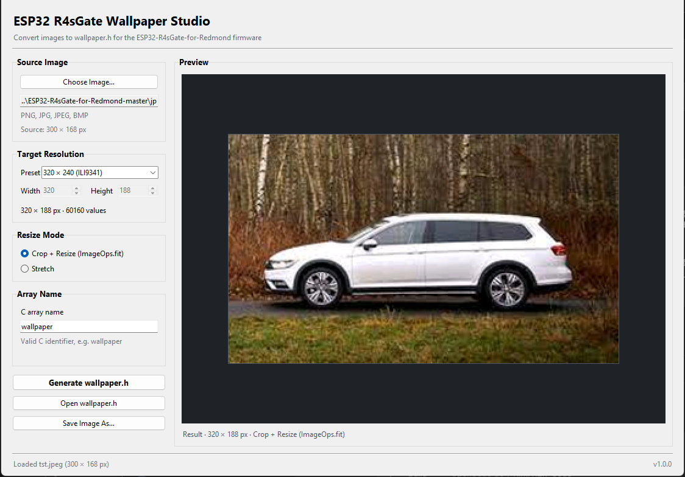
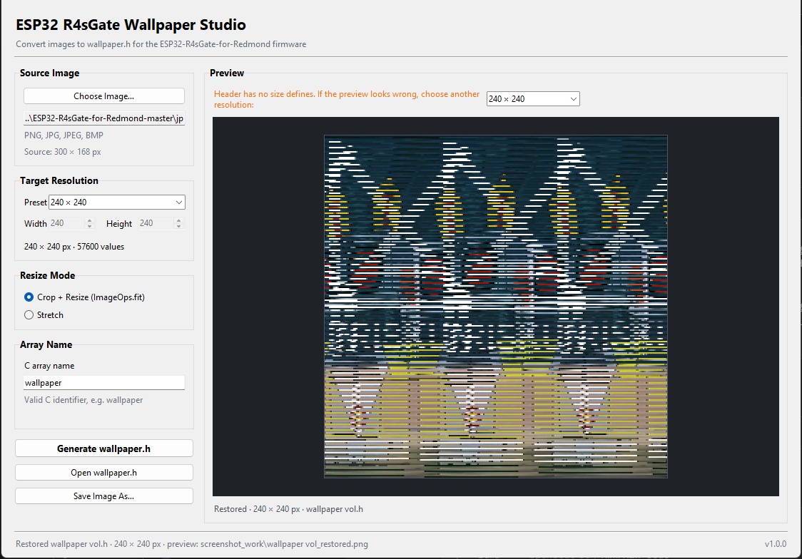
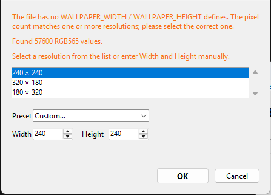

# ESP32 R4sGate Wallpaper Studio

Конвертер изображений в `wallpaper.h` (RGB565) для прошивки
[**ESP32-R4sGate-for-Redmond**](https://github.com/alutov/ESP32-R4sGate-for-Redmond)
и обратное восстановление PNG из готового заголовка.

## Возможности

- **Источники**: PNG, JPG/JPEG, BMP. Размер источника определяется автоматически.
- **Целевые разрешения**: 320 × 240 (ILI9341), 240 × 320, 240 × 240, 170 × 320,
  135 × 240, 128 × 160, 320 × 188 (область обоев R4sGate) и произвольный размер.
- **Режимы масштабирования**:
  - «Обрезка + масштаб» (`ImageOps.fit`) — сохраняет пропорции, обрезает лишнее.
  - «Растянуть» — подгоняет под заданный прямоугольник.
- **Генерация заголовка** с `#pragma once`, `#include <stdint.h>`,
  `#define WALLPAPER_WIDTH / HEIGHT` и массивом `const uint16_t <name>[N]`
  (16 значений в строке, `0xRRRR`).
- **Открытие готовых `*.h`**: размеры берутся из `#define WALLPAPER_WIDTH/HEIGHT`.
  Если их нет, показывается диалог со всеми подходящими разрешениями и ручным
  вводом. После открытия над предпросмотром можно быстро переключаться между
  вариантами разрешений — картинка перестраивается сразу.
- **Сохранение результата**: предпросмотр сохраняется рядом с заголовком как
  `<имя>_restored.png`, а через «Сохранить изображение как…» можно выгрузить
  результат в PNG, JPG/JPEG или BMP.
- **Живой предпросмотр**: исходник, результат в RGB565 и восстановленное
  изображение.
- **Интерфейс на русском и английском**, переключение в меню **Язык** без
  перезапуска. Язык по умолчанию определяется по системе
  (ru/uk/be → русский, иначе English).

## Скриншоты


*Главное окно: выбрана картинка, пресет 320 × 188, виден предпросмотр результата.*


*Открыт `wallpaper.h` без `WALLPAPER_WIDTH/HEIGHT`. Над предпросмотром доступен*
*выбор из нескольких подходящих разрешений; переключение обновляет картинку сразу.*


*Диалог, который появляется, если в заголовке нет определений ширины/высоты.*

## Требования

- Python 3.11+ с Tkinter.
- Pillow (`requirements.txt`).
- PyInstaller — только для сборки `.exe`.

## Запуск

```bat
py -m venv .venv
.venv\Scripts\python -m pip install -r requirements.txt
.venv\Scripts\python main.py
```

## Сборка EXE

```bat
.venv\Scripts\python -m pip install pyinstaller
.venv\Scripts\python -m PyInstaller --onefile --windowed main.py
```

Готовый файл: `dist\R4sGate-Wallpaper-Studio.exe`. Можно использовать `build.bat`,
который делает то же самое.

## Как пользоваться

1. **Изображение → `wallpaper.h`**:
   - *Файл → Открыть изображение…* (Ctrl+O).
   - Выберите пресет или укажите произвольный размер.
   - Выберите режим масштабирования.
   - *Файл → Создать wallpaper.h…* (Ctrl+G).
2. **`wallpaper.h` → PNG**:
   - *Файл → Открыть wallpaper.h…* (Ctrl+H).
   - Если размеров нет, выберите нужное разрешение в диалоге.
   - При необходимости поменяйте разрешение в выпадающем списке над
     предпросмотром.
   - *Файл → Сохранить изображение как…* (Ctrl+S) для экспорта в PNG/JPG/BMP.

## Совместимость с прошивкой

- Формат значений:
  `RGB565 = ((r & 0xF8) << 8) | ((g & 0xFC) << 3) | (b >> 3)`.
- Обратное преобразование расширяет компоненты до полного диапазона
  (`v * 255 // 31`, `v * 255 // 63`, `v * 255 // 31`).
- В прошивке `main/tft/tft.c` обои рисуются через
  `pushImage(0, 52, 320, 240, wallpaper)`, поэтому видимая область экрана —
  **320 × 188**, начиная с `y = 52`.
- Старый `wallpaper.h` из прошивки (объявлен как `unsigned short wallpaper[60160]`,
  без `WALLPAPER_WIDTH`/`WALLPAPER_HEIGHT`) открывается корректно: комментарии
  вида `// 0x0F10 (3856) pixels` игнорируются, размер предлагается 320 × 188.

## Тесты

```bat
.venv\Scripts\python -m unittest discover -s tests -v
```

## Структура

| Файл | Назначение |
| --- | --- |
| `main.py` | графический интерфейс (Tkinter/ttk) |
| `converter.py` | RGB565, масштабирование, чтение и запись заголовков |
| `localization.py` | строки ru/en и определение языка системы |
| `tests/` | модульные тесты |

---

# English

Converts images into an RGB565 `wallpaper.h` for the
[**ESP32-R4sGate-for-Redmond**](https://github.com/alutov/ESP32-R4sGate-for-Redmond)
firmware and restores PNG previews from existing headers.

## Features

- **Input**: PNG, JPG/JPEG, BMP; source size is detected automatically.
- **Target presets**: 320 × 240 (ILI9341), 240 × 320, 240 × 240, 170 × 320,
  135 × 240, 128 × 160, 320 × 188 (R4sGate wallpaper area) and custom sizes.
- **Resize modes**: crop + resize (`ImageOps.fit`) and stretch.
- **Header output**: `#pragma once`, `#include <stdint.h>`,
  `#define WALLPAPER_WIDTH / HEIGHT`, `const uint16_t <name>[N]`, 16 values per
  line.
- **Opening `*.h`**: reads the size from `WALLPAPER_WIDTH`/`WALLPAPER_HEIGHT`;
  when missing, a dialog lists every matching resolution and lets you enter a
  custom size. After opening, a combobox above the preview lets you switch
  resolutions instantly.
- **Export**: the restored preview is saved as `<name>_restored.png` next to the
  header, and the result can be exported to PNG, JPG/JPEG or BMP via Save Image
  As.
- **Russian/English UI** with live switching in the **Language** menu
  (auto-detected at startup).

## Screenshots


*Main window with a loaded image, 320 × 188 preset and live RGB565 preview.*


*A `wallpaper.h` without `WALLPAPER_WIDTH/HEIGHT` was opened. The combobox above*
*the preview lets you pick the correct resolution and see the result immediately.*


*Dialog shown when a header has no width/height defines.*

## Usage

1. **Image → `wallpaper.h`**:
   - *File → Open Image…* (Ctrl+O).
   - Choose a preset or enter a custom size.
   - Select a resize mode.
   - *File → Generate wallpaper.h…* (Ctrl+G).
2. **`wallpaper.h` → PNG**:
   - *File → Open wallpaper.h…* (Ctrl+H).
   - If the size is missing, select the correct resolution in the dialog.
   - Switch resolutions from the combobox above the preview if needed.
   - *File → Save Image As…* (Ctrl+S) to export PNG/JPG/BMP.

## Build

```bat
.venv\Scripts\python -m pip install pyinstaller
.venv\Scripts\python -m PyInstaller --onefile --windowed main.py
```

Output: `dist\R4sGate-Wallpaper-Studio.exe`.

## Tests

```bat
.venv\Scripts\python -m unittest discover -s tests -v
```

## Files

| File | Purpose |
| --- | --- |
| `main.py` | Tkinter/ttk GUI |
| `converter.py` | RGB565, scaling, header read/write |
| `localization.py` | ru/en strings and language detection |
| `tests/` | Unit tests |
